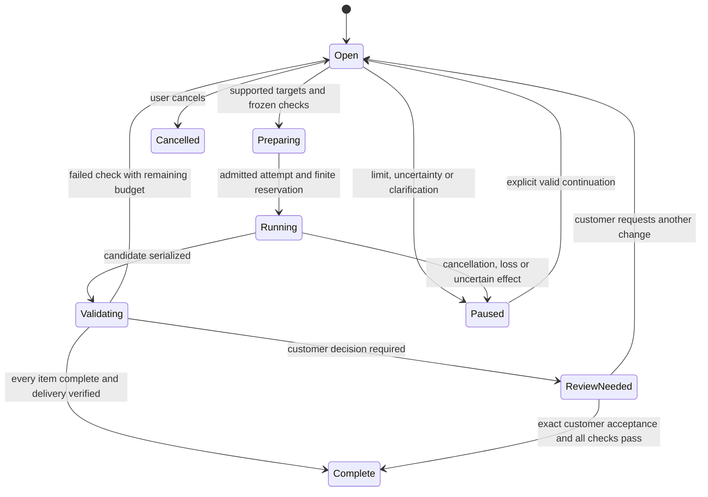

<!-- SPDX-License-Identifier: CC-BY-4.0 -->
# HH-08 — Durable report and workbook revisions from user comments

Status: needs-triage
Type: implementation specification; documentation only in this commissioning task
Priority: high
Baseline: `60d8332d64b2edef1b204fb5980311e6102229a8` (30 October 2026)
Dependencies: HH-05 characterization; HH-03 for physical inference sends; HH-09A owns the shared authoritative IntentContract/DecisionPacket store, CAS/checker/decision APIs and acceptance IDs, independently of HH-09B delegation. HH-10 owns deferred asynchronous input snapshot coverage. HH-01 owns input admission, HH-02 engineering requirements, HH-04 reference pilot, HH-06 study and HH-07 research. These dependencies grant no artifact effects.

## 1. Outcome and first delivery

A user can generate a report and results workbook, give several comments, receive focused new copies, and continue across chats, providers and restarts until every item is addressed or explicitly withdrawn. Questions, unsupported edits, failed exports and failed validation keep the task open. Budgets stop execution without converting unfinished work into success. “Until satisfied” is not an unbounded scheduler or inferred customer approval.

**HH-08A is the first implementation slice:** saved-project `ReportDocument` revisions and app-generated results `.xlsx`, using a closed registry of report paragraph/bullet edits and workbook text/number-format edits. Report changes preserve evidence references and disclosures; workbook changes cannot change numeric data, formulas, chart ranges or source assumptions. Support generating the initial artifacts through existing pipelines, then up to five targeted comments in one task, including the journey in §10. Default limits: five revision rounds, twenty items, two candidate attempts per item per round, two concurrent tasks per owner/project, six hours of elapsed active execution, and existing lower task/provider/token/cost limits. Raising limits requires an explicit versioned task amendment; it never restores consumed reservations. Pause after two attempts that make no measurable progress.

HH-08A must include persistence, stale-base rejection, independent native validation, export reconciliation, review routing and Activity. It is not complete if it merely adds a prompt asking the model to remember comments. Follow-on **08B** adds named, code-composed formula repairs and evidence-backed numeric replacements for specific workbook builders with independently tested unit/basis/dependency mappings. **08C** adds selected DOCX-import revision targets and any additional native report/export adapters after fidelity characterization. General uploaded workbook editing, arbitrary formulas, arbitrary DOCX editing and PDF import remain unsupported. Each expansion needs exact operations, files, review routes and fixtures before availability is advertised.

## 2. Audit: reuse shipped behavior, identify the missing controller

The baseline includes the results-workbook engine, network/grid/adequacy/finance view builders, scenario handling, budget handling and picker/chat tool merged on 29–30 October. Older scratch issue statuses and the 12 October injection finding are not current implementation evidence.

| Existing source, relative to `pypsa-gui/` | Reuse and actual limit |
| --- | --- |
| `backend/models/report.py`; `backend/services/reports/store.py` | Typed prose/reference blocks, section source/audit/comments/pending instruction; immutable `vN.json` files and readable prior versions. `save_version` selects the next number; that alone is not expected-base CAS or a multi-artifact transaction. |
| `backend/routers/report_jobs.py`; `backend/services/reports/report_job.py` | Generate and one-section regeneration, bounded repair, progress, abort and generation receipt. Regeneration copies the base and preserves other sections, consumes a pending instruction and saves a new version. Current routes read latest and collect current evidence; they do not freeze a multi-comment acceptance ledger. A `done` job may contain prose failures and is not task acceptance. |
| `backend/services/reports/evidence.py`, `assemble.py`, `number_audit.py` | Code-owned tables/figures and evidence slices; numeric-token audit. Audit matches values and permits some bare-number matches; it does not prove a sentence's metric, entity, basis or conclusion. Preserve it, add explicit fact bindings for changed factual claims. |
| `backend/services/reports/roundtrip.py`, `roundtrip_service.py`; `backend/routers/reports.py` | Edited DOCX becomes a new native version, comments become pending instructions, diffs and optional template binding exist. Stable bookmarks are preferred but heading matching is fuzzy; tracked changes are accepted; edited tables can become user-authored tables; added pictures receive a disclosure. This is not lossless Word package editing or automatic factual approval. |
| `backend/services/reports/docx_writer.py`, `template_tagged.py`, `template_untagged.py`, `pdf.py` | Existing python-docx/template rendering and optional host LibreOffice PDF conversion. Use capability checks and existing failures; no invented native Office library. PDF is a rendered derivative, not editable report authority. |
| `backend/services/results_workbook/__init__.py`, `registry.py`, `overview.py`, `finance.py`, `scenarios.py`, `views_network.py`, `views_grid.py`, `views_adequacy.py`, `budget.py`, `charts.py`, `cells.py` | Existing `WorkbookInputs` → openpyxl XLSX, native charts referencing local cells, explicit missing values, aggregation disclosures and 25 MB cap. Builders may catch a view failure, delete its partial sheets and return a usable workbook whose About sheet says error; size fallback may omit whole view sheets. Bytes returned therefore do not establish complete delivery. |
| `backend/routers/results.py:get_results_workbook`, `get_results_workbook_views`; `backend/services/chat_tools.py:export_results_workbook` | Existing `/api/results/workbook.xlsx`, view selection, current/stored freshness handling and authenticated export chip. `stored=true` uses the available stored solve state; it is not an arbitrary historical-run selector or an immutable frozen snapshot. Route collection can read live state and latest run metadata; HH-08 must establish their compatibility, not trust the displayed About label. |
| `frontend/src/pages/reports/SectionCard.tsx`, `ReportViewer.tsx`, `RoundTripPanel.tsx`, `VersionDiffView.tsx`; `frontend/src/layout/sidebar/ResultsWorkbookPicker.tsx` | Reuse report target selection, regeneration controls, comments, version diff and the one export chooser. Add a bounded task checklist in these surfaces and existing Activity; no second document editor or competing export menu. |
| `backend/services/assistant_tasks.py`; `backend/harness/job_adapters.py`, `activity_history.py`, `completion_observer.py` | Existing task limits/claims, report handles, bounded waits and retained status observations. Native job status is observational, not acceptance authority. Worker-loss reconciliation currently cannot reconstruct all effects; add artifact receipts rather than treating lost registration as no effect. |

Characterize `test_report_job.py`, `test_report_roundtrip.py`, `test_report_roundtrip_routes.py`, `test_report_docx_writer.py`, `test_results_workbook.py`, `test_results_workbook_export.py`, `test_results_workbook_budget.py`, the `test_results_workbook_views*.py` tests and `test_export_formula_injection.py` before changes. Current injection protection is shipped: network CSV/XLSX export escapes formula-looking strings and imports reverse the escape; results-workbook `cells.put` delegates text/formula separation to `services/study/workbook_view.py`. Preserve both sink contracts, including legitimate negative numeric values.

## 3. Durable data and exact identities

Add `ArtifactRevisionTask` to the existing owned assistant task. Import HH-09's `IntentContractV1`, `AcceptanceItemV1`, `AcceptanceCoverageV1`, `DecisionPacketV1` from proposed `harness/decision_packets.py`. Each feedback comment maps to explicit shared acceptance IDs before execution; HH-09 owns their definition/amendment/closure. The artifact record references `(intent_id, intent_revision, intent_sha256, acceptance_id)` and supplies operational evidence. Conversation stores only task ID/observation tuple. Use owned-store transactions and `(task_revision, task_digest)` CAS; actor/project checks precede reads. Legacy prose never becomes authority.

```text
ArtifactRevisionTask v1
  task_id, owner_id, project_id, parent_thread_id?, binding_generation
  task_revision, task_digest, intent_id, intent_revision, intent_sha256
  decision_packet_ref
  request_id, created_at, limits, consumed, copy_revision_grant_ref?
  phase, execution_status, acceptance_status, pause_reason?
  artifacts[]: ArtifactRef, base_ref, candidate_ref?, published_ref?
  items[]: ArtifactAcceptanceBinding; attempts[]; operation_receipts[]; audit_origins[]

ArtifactRef v1
  artifact_id, kind: report|results_xlsx, native_version, adapter_id/version
  logical_digest, package_sha256?, source_snapshot_id, source_digest
  template_digest?, builder_version, semantic_manifest_digest

ArtifactAcceptanceBinding v1 (references shared AcceptanceItemV1)
  acceptance_id, intent_revision, source_comment: owned_ref + digest + anchor
  shared_item_digest, target_refs[], exact_base_ref, proposed_patch_ref?
  frozen_check_refs[]: shared check_id/version + immutable parameters digest
  review_route: software|customer; review_reason?
  coverage_ref: AcceptanceCoverageV1; display_state (derived, no authority)
  verification: pending|passed|failed|unavailable
  candidate_ref?, validation_receipt_ref?, customer_decision_ref?, reason?
```

An item can target one or several report section/block IDs, or exact worksheet/range and semantic field IDs. Workbook IDs are generated by the builder manifest and bound to its version; coordinates alone cannot survive row insertion, renamed sheets or a different export layout. Resolve visible comments against the inspected artifact, not the newest export or fuzzy similarly named section. Ambiguity remains unresolved with candidate targets shown. HH-04's current pilot does not contain an ArtifactRef: this issue owns this new private type without broadening that pilot.

Persist one immutable comment source and separate child items for distinct requests; one comment can have multiple obligations. Source references distinguish explicit user text, imported comments and model proposals. Uploaded text is untrusted data. Repeated ingestion deduplicates by owned source identity and content digest; changed text creates an amendment, not an overwrite. Global/unmatched DOCX comments remain unresolved until targeted. Legacy concatenated pending instructions remain readable but cannot silently become five independently satisfied requirements.

Freeze shared acceptance checks before generation. Software maps requests to registered literal replacement, removed phrase, permitted block diff, unchanged fact/ref set, exact cell text/format, requested-view completeness and preservation checks. Models can propose interpretations, not executable tests, reduced coverage or success. Vague aesthetic/domain requests need customer review or clarification. Explicit user amendments/withdrawals retain history; changed checks invalidate affected successes.

Limits: comment 4 KiB, intent 2 KiB, forty targets/task, twenty checks/item, metadata 512 KiB excluding artifacts. Page history, preserve all active items in context, and refuse overflow. No credentials, arbitrary paths or workbook arrays in model context.

## 4. Native generation, patching and independent validation

For initial generation capture a native source snapshot before provider work: exact report evidence/figures/template bytes, or materialized workbook builder inputs/results and investment-case/scenario compatibility, including units, horizon, weights, money year and currency. Capture identity and data together under the relevant native source read lock, then release it before model/rendering work. Do not serialize a callable or shared mutable network as a snapshot. In 08A materialize the initial workbook and a code-emitted semantic/fact manifest from that same coherent build; if a builder cannot supply frozen inputs or prove source compatibility, refuse that adapter. Never combine a latest manifest's run label with unverified live values. A stale historical snapshot can remain a valid historical artifact; changing the live project does not silently refresh its sources.

The controller reuses native services:

1. Read exact sources, native base and immutable checks. Record attempt reservation and owned job origin.
2. Produce a typed proposed patch against that base. For report prose, use existing generator/evidence slicing with a new **candidate-only** return path; it must not call `save_version` before validation. For simple literal edits use deterministic code without a model call. No unrelated section is sent for regeneration.
3. Apply allowed operations to a private candidate. Report patches may replace named paragraph/bullet blocks; preserve code-owned tables, figures, evidence gaps, required disclosures, units and other sections. XLSX patches may set a named display-text cell or `number_format` within a registered range. A label edit cannot alter a numeric cell's type. No insert/delete/reorder/merge operations in 08A.
4. An independent native validator reloads the serialized candidate and recomputes every frozen check, source binding and untouched-region manifest. It uses code and original sources, not the generator's “looks good” response. A separate bounded model review can provide advisory prose feedback; it has no completion authority and consumes HH-03 budget.
5. Render/export into private staging; reopen and validate the actual DOCX/XLSX package. PDF additionally checks successful conversion, nonempty valid output and source binding. Record renderer capability and warnings. Commit immutable artifact versions and delivery receipts only after the operation's required outputs pass. A task-level publication manifest links separately atomic artifacts; do not claim filesystem-wide atomic commit.

Generated numbers, report table cells and numeric workbook data come from frozen native results and their explicit fact paths, never model-supplied values. A request to change a capacity, financial assumption, conclusion of compliance or result is routed to the appropriate ordinary engineering/research/study workflow and linked as unresolved here. It cannot edit a report into making the result true, invoke a solve during export, approve an investment case or waive HH-02 requirements. Existing user-edited DOCX tables retain user authorship; they cannot be relabeled native-verified facts.

08B must separately enumerate permitted numeric source-field mappings and code-owned formula templates. Backend recomputation validates known metrics with declared units, tolerances and cost basis. openpyxl writes formulas but does not calculate them. `backend/tests/xlsx_formula_eval.py` is a small test-only SUM/NPV/arithmetic evaluator, not a production Excel engine. Optional LibreOffice recalculation is useful compatibility evidence, not proof of complete Microsoft Excel equivalence. Record `native_calculation`, `formula_structure`, `libreoffice_recalc` and `excel_compatibility` separately; unavailable formula-engine validation stays unavailable and blocks items whose frozen checks require it. Cached Excel values or a recalculation flag do not prove correctness.

## 5. Preservation, formats and hostile content

The preservation contract is **logical equality**: unchanged report blocks/metadata, tables, figures, provenance and template binding; unchanged workbook values/types/formulas/styles, dimensions, order, hidden state, merges, charts and references outside permitted targets. Compare semantic objects, excluding ZIP timestamps, relationship ordering and generated package IDs. No binary-identity promise after serialization; retain original bytes for download/undo. If a library loses a required feature, refuse the adapter.

The adapter registry is closed: `report_document_v1` → existing DOCX rendering and optional PDF derivative; `results_workbook_v1` → app-generated `.xlsx` with registered builder manifest. CSV/network Excel, finance standalone workbooks, guided-study workbooks and asset exports are existing independent pipelines, not automatic revision coverage. `.xls`, `.xlsb`, `.xlsm`, encrypted/password-protected files, macros/VBA, OLE, unsupported drawings, pivot/data-model structures and arbitrary uploaded spreadsheets are explicitly unsupported. A matching extension is insufficient. DOCX roundtrip is a supported existing import flow with documented normalization; 08A can point to its resulting native version, but may not autonomously accept fuzzy heading matches, tracked-change decisions or edited factual tables. PDF import/OCR-to-editable-report has no installed adapter.

All generated or edited string cells use existing inert text writers, including text beginning `=`, `+`, `-`, `@`, tab or carriage return. Preserve real numeric types and existing intentionally generated formulas. Do not remove apostrophes wholesale or turn a user comment into a formula. Validate actual serialized cell types and formula provenance.

At package admission and after rendering, inspect relationships, defined names, formulas, chart links and hyperlinks without dereferencing them. Refuse external workbook references, DDE, external data connections, formulas such as WEBSERVICE/HYPERLINK, executable/embedded content, and newly introduced remote relationships outside the adapter's declared passive-link policy. Do not fetch remote images or update links. Existing passive report citations can remain as inert links when explicitly recorded; adding a new link requires a visible patch and allowed URL scheme, never a background network call. Private LibreOffice conversion must run with network access denied and bounded time/resources; inability to enforce that boundary disables this adapter. Comments, sheet names and imported documents cannot change tools, approvals or publication policy.

## 6. Completion, customer review and bounded iteration

The task-review card may issue a **new narrow native copy-revision grant**, using HH-09's policy/admission seam. Bind owner/project, intent/packet revisions, acceptance IDs, root base digests, adapter versions, formats, operations, version/attempt caps and expiry. Each step requires its exact current base and receipt-proven descendant lineage. Outputs are derivative copies; published baselines and model inputs remain immutable. Authorized typo/label/format changes and read checks proceed without repeated cards. Model prose needs explicit coverage and frozen factual/preservation checks; otherwise pause. Factual/data/formula/assumption changes need their declared policy and supported adapter. Implement this native grant, never a prompt bypass. Unsupported coverage keeps the manual path with an explicit limitation. Consumption persists; new acceptance IDs require amendment. Mandatory model-parameter/research approvals remain unchanged.



The chart is execution/UI projection; HH-09 exclusively owns closure. Map shared `pending/running` to open, `unsupported/incomplete/failed` to unresolved, `needs_user` to “Review needed,” and `accepted` to complete. `software_passed` remains open until shared closure admits it; absent required user judgment, deterministic receipts may establish acceptance. `superseded` is shown as withdrawn/replaced only with its explicit user decision. Cancellation satisfies nothing; overlapping patches invalidate dependent coverage. No independent artifact `all_done` bit overrides shared state.

Route review by **check coverage and requested meaning**, never LLM confidence. Literal edits/formats can complete through software when frozen checks pass. Tone preferences, ambiguity, substantive interpretations, changed factual authorship, domain judgments or requested sign-off need customer review/a linked workflow. Software verification and download are not customer acceptance. Acceptance binds actor, item revision, exact artifact digest and displayed decision; it cannot bypass failed security/factual checks or certify engineering results. Later feedback opens a new revision and retains historical decisions.

Submit artifact/check/delivery receipts into shared `AcceptanceCoverageV1`; every requested deliverable, absence of uncertain effects and required customer decisions must be represented there. HH-09 derives request closure, never an independent artifact completion predicate. Successful HTTP/job status, cleared instructions or model prose cannot close coverage. Safe partial exports remain labeled drafts with omissions/open items; never unqualified “ready.”

## 7. Hours-long jobs, concurrency, recovery and undo

Use the existing task origin in Activity and report handles for children. Show item counts, operation, attempt, heartbeat, limits, draft/verified/review-needed labels and pause reason. Inspection/reconnect starts nothing. Bounded waits leave chat usable without hours-long HTTP streams. Persist revisions, candidates, sources, resource consumption and receipts before transitions. HH-03 covers inference/reviewer sends; task limits separately count exports, attempts, staging bytes and active elapsed time.

Operation idempotency binds task/item revision, base, patch, format and attempt. Persist `prepared → effect_intent → native_committed → validated → published`, or `failed/uncertain`, with immutable receipts. No new key escapes uncertainty. Extend upload delivery lookup so crash-after-registration recovers the same file ID/digest. Discard staging only with positive no-publication proof; lease expiry/worker loss is insufficient. Restart reads exact native versions/receipts, attaches once or pauses unresolved. No duplicate export/version or automatic replay.

Recheck owner/project access and base digest at admission, worker pickup and publication. Serialize publication by expected latest artifact version and task CAS under the relevant owned-store lock. Every supported writer to that artifact head, including ordinary regeneration, roundtrip import and user template changes, must participate in the same narrow publication lock; otherwise the revision adapter remains unavailable. Never hold a lock while waiting for a user, inference or rendering. A user edit during generation causes a conflict; keep the private candidate and show a diff, then require explicit rebasing of affected targets/checks. No last-writer-wins overwrite or automatic fuzzy merge. An independent artifact in the same task may commit while another conflicts, but the task stays open.

Pause prevents new operations and lets an admitted operation reach a recorded safe boundary. Cancel sets a durable stop fence and invokes existing report abort where applicable; waiting cancellation is distinct from aborting the child. Late completion is recorded honestly without publishing after the cancel fence. Undo creates a new version referencing the chosen prior immutable artifact; it never deletes audit history, reverses model charges, restores approvals or modifies source model inputs. Revalidate the resulting task items. Already downloaded files remain historical copies.

## 8. Proposed APIs, tools and exact implementation allowlist

These are new contracts, not descriptions of shipped endpoints. Routes live under `/api/projects/{name}/artifact-revisions`; all writes retain ordinary mode/tier policy, exact base/check previews and native lock checks. No checked-answer profile expansion or unattended solve approval is included.

```text
POST /artifact-revisions
  {request_id, artifact_refs, comment_source_refs, limits?}
GET  /artifact-revisions/{task_id}
POST /artifact-revisions/{task_id}/prepare
  {request_id, expected_task_revision, expected_task_digest, acceptance_ids}
POST /artifact-revisions/{task_id}/advance
  {request_id, expected_task_revision, expected_task_digest, prepared_digest}
POST /artifact-revisions/{task_id}/amend
  {request_id, expected_task_revision, expected_task_digest, changes}
POST /artifact-revisions/{task_id}/control
  {request_id, expected_task_revision, expected_task_digest,
   action: pause|cancel|continue|undo|accept, exact_decision_ref?}
```

`prepare` publishes/sends nothing; `advance` admits one bounded operation and returns a stable task/job reference. `continue` cannot renew grants, release uncertain budget or silently rebase. `accept` is user-only; undo uses exact-edit confirmation. New wrappers: `start_artifact_revision`, `get_artifact_revision`, `prepare_artifact_revision`, `advance_artifact_revision`, `amend_artifact_revision`, `control_artifact_revision`. Control excludes acceptance and unconfirmed rearming/undo. Reads are read tier; start/prepare/amend write tier; advancement uses its native adapter tier and validated narrow grant when supported. No raw checks, paths or formulas from tools.

Allowed implementation paths below are exact; names marked new are proposed. Only this issue file is written by the present task.

| Paths | Permitted work |
| --- | --- |
| **New** `pypsa-gui/backend/services/artifact_revisions.py`, `artifact_revision_adapters.py`; **new** `pypsa-gui/backend/models/artifact_revision.py` | Closed schema/registry, native manifests, CAS transitions, frozen validation and recovery. Attachment authority remains the assistant task. |
| `pypsa-gui/backend/services/assistant_tasks.py`, `durable_conversation.py`; `pypsa-gui/backend/harness/durable.py` | Typed task attachment, narrow transactions/locks, persistent parent reference and item-aware completion; preserve legacy tasks and HH-03 counters. |
| `pypsa-gui/backend/services/reports/report_job.py`, `store.py`, `roundtrip_service.py`, `pdf.py`; `pypsa-gui/backend/routers/report_jobs.py`, `reports.py` | Candidate-only generation and expected-base publication, participating existing writers, renderer boundary. No report content-model redesign. |
| `pypsa-gui/backend/services/results_workbook/__init__.py`, `registry.py`, `cells.py`, `charts.py`, `overview.py`, `finance.py`, `scenarios.py`, `views_network.py`, `views_grid.py`, `views_adequacy.py`; `pypsa-gui/backend/routers/results.py` | Frozen coherent build, code-emitted manifests, named text/format targets and machine-readable per-view omissions/errors. Preserve ordinary export behavior. |
| `pypsa-gui/backend/services/upload_service.py`; `pypsa-gui/backend/harness/job_adapters.py`, `activity_history.py`, `completion_observer.py`, `continuation.py` | Idempotent artifact delivery receipt and existing Activity/continuation observation; no scheduling authority from status alone. |
| **New** `pypsa-gui/backend/routers/artifact_revisions.py`; `pypsa-gui/backend/main.py`; `pypsa-gui/backend/services/chat_tools.py`; `pypsa-gui/backend/harness/catalogue.py`, `toolsets.py`, `README.md` | Router registration, exact wrappers/tool declarations/route maps and true coverage documentation; all calls use existing dispatch/identity/confirmation policy. |
| **New** `pypsa-gui/tool-error-kinds.d/claude-hh08-artifact-revisions.json`; **new** `pypsa-gui/backend/smoke/assistant_route_parity_declarations.d/claude-hh08-artifact-revisions.json`; **new** `doc/release-notes.d/claude-hh08-artifact-revisions.md` | Typed errors `artifact_revision_conflict`, `artifact_adapter_unsupported`, `artifact_source_unavailable`, `artifact_validation_failed`, `artifact_effect_uncertain`, `artifact_revision_limit`; route dispositions and release record. Regenerate inventories only with repository generators. |
| **New** `pypsa-gui/frontend/src/api/artifactRevisions.ts`, `pages/reports/ArtifactRevisionChecklist.tsx`; `pypsa-gui/frontend/src/pages/reports/ReportViewer.tsx`, `SectionCard.tsx`, `RoundTripPanel.tsx`, `VersionDiffView.tsx`; `pypsa-gui/frontend/src/layout/sidebar/ResultsWorkbookPicker.tsx`; `pypsa-gui/frontend/src/components/AssistantActivity.tsx`; `pypsa-gui/frontend/src/api/assistantActivity.ts` | Scoped checklist, exact targets/diff, decisions and existing Activity integration; accessible controls and no automatic send on open. |
| **New** `pypsa-gui/backend/tests/test_artifact_revisions.py`, `test_artifact_revision_http.py`, `test_artifact_revision_recovery.py`, `test_artifact_revision_preservation.py`; **new** `pypsa-gui/frontend/src/pages/reports/ArtifactRevisionChecklist.test.tsx`, `api/artifactRevisions.test.ts` | §10 fixtures and deterministic assertions. Add focused regressions to existing audited report/workbook/task/Activity tests. |

Rebase against current code before implementation; if registration or publication requires another path, amend this allowlist with the exact seam and tests. Do not silently add Office dependencies, provider-specific loops, arbitrary filesystem tools or a new application-wide job scheduler.

## 9. Migration, rollout and rollback

Add version readers and characterization, then opt-in `artifact_revision_v1` for the two adapters. Only inspected native artifacts with complete manifests become bases. Explicit regeneration can establish a new legacy-workbook base; never fabricate mappings or historical digests. Offer legacy comments as drafts requiring inspection; never migrate finished legacy tasks into acceptance.

Unknown versions/corrupt checkpoints pause with readable diagnostics and preserved bytes; no repair-to-empty. Keep task records and immutable artifact audit for the existing owned project lifetime. Store large artifact bytes through existing private storage policy, not analytics. Foreign IDs are not-found; no content/count leakage. Reconnect/logout/project changes clear stale UI observations, while retained task state remains private.

Rollback disables new advancement and publication, preserves records, receipts, draft files and unresolved budget holds, and leaves ordinary native/manual artifact tools available under their existing policy. It must display that revision validation is unavailable instead of claiming task completion. Re-enable only after schema/source/receipt validation; old approvals do not reactivate. No destructive format migration is required for 08A.

## 10. Acceptance tests and the required user journey

Use fake providers, small saved-project fixtures and real native serializers; no paid calls or heavy solve is required. Tests assert persisted items, reloaded artifacts and native receipt identities, not helper counts or pleasing prose. HH-05 consumes these trajectory IDs independently of provider choice.

| ID | Scenario and required observable outcome |
| --- | --- |
| A01 | Generate report plus selected-results workbook; reload both and verify matching frozen source/basis manifest and requested formats. |
| A02 | Three report comments plus two workbook fixes; all five source origins and exact targets survive provider switch, trimming and episode recreation. |
| A03 | Two literal report fixes pass deterministic checks with no customer click; a substantive interpretation remains review-needed. |
| A04 | One of five items lacks evidence; four complete, one unresolved, task open, no ready claim. |
| A05 | Generator says complete while a frozen check fails; native state remains open and bounded next attempt uses the same checks. |
| A06 | Model attempts to drop a check/withdraw an item/change source digest; strict parsing refuses and audit remains intact. |
| A07 | Unrelated report section/table/figure/disclosure changes in a candidate; preservation validator refuses publication. |
| A08 | Workbook text/format patch changes another cell, formula, type, style, chart or hidden state; independent reload fails preservation. |
| A09 | Repeated comment ingestion deduplicates; amended source creates a new item revision without erasing the old one. |
| A10 | Ambiguous, global, unmatched or fuzzy-DOCX target; no automatic edit, explicit unresolved targeting. |
| A11 | User edits report/template/workbook base during generation; expected-base publication conflicts and preserves user work. |
| A12 | Two workers advance the same revision; one reservation/publication wins, no duplicate export/version. |
| A13 | Crash at every operation checkpoint, including after upload commit/before response; recovery returns same native file/version or unresolved, never replay. |
| A14 | Missing worker/expired lease without receipt proof; uncertain remains, consumed caps are not reset. |
| A15 | Pause/cancel during inference/render/export and late worker finish; no new operation or post-cancel publication, honest late receipt. |
| A16 | Six-hour/attempt/token/cost exhaustion or repeated no-progress; task pauses open, resume cannot reset counters/holds. |
| A17 | Builder catches a selected-view failure, coarsens data or drops a size-limited sheet; manifest/disclosure exact, required missing view blocks completion. |
| A18 | Unsolved/stale/current/stored cases, scenario basis mismatch and mismatched latest-run metadata; no silent solve, latest fallback or mixed source facts. |
| A19 | Formula-looking names/comments/text including tab/CR, negative numbers and imported apostrophes; inert text roundtrip and intended formulas retain types. |
| A20 | External links, DDE, connections, macros, malicious formulas and remote template/image relationships; no network access, adapter refuses. |
| A21 | Formula structural check passes but no compatible engine/cache; calculation status unavailable and any required engine check stays unresolved. |
| A22 | Native numeric mismatch, wrong metric/entity/unit/basis or coincidentally equal audit token; unsupported replacement/domain claim cannot pass. |
| A23 | DOCX render/import tracked edits, edited tables, lost bookmark, new picture and optional PDF capability failure; documented normalization and authorship, no lossless/editable-PDF claim. |
| A24 | Undo makes a new immutable version; old files/charges/decisions retained and overlapping acceptance revalidated. |
| A25 | Customer accepts exact reviewed digest; later change invalidates decision; download/Choice/model confidence cannot substitute. |
| A26 | ACL loss/foreign IDs/logout/project switch/unknown schema/rollback; no leaked artifacts, no resumed effects or false validation badge. |
| A27 | Same inputs through UI and chat yield semantically identical sheets and target manifests; ZIP byte identity is not required. |
| A28 | All items complete but one required DOCX/PDF/XLSX delivery is missing/corrupt; task remains unresolved until exact validated receipt exists. |
| A29 | Copy-revision grant covers typo/format operations: repeated corrections proceed without cards; different base/item/format/operation, expiry, rollback or exhausted cap refuses before effects. Original published bytes survive. |

Required end-to-end journey: the user generates report v1 and results workbook w1, then requests (R1) correct an executive-summary typo, (R2) shorten a named methodology paragraph while retaining its disclosure, (R3) explain whether an unavailable grid-compliance result proves compliance, (W1) correct a worksheet label and (W2) display an existing monetary range with two decimals. In round one, R1/W1/W2 pass literal/format and preservation checks; R2 fails its retained-disclosure check and stays open; R3 lacks native evidence and becomes unresolved with its exact question retained. Round two fixes R2 and passes independent validation. Activity now shows four of five addressed and “One item needs evidence”; the task remains open across reload/provider switch, despite successful exports. The user can supply an authorized native result through the separate workflow, clarify R3 into an evidence-gap disclosure, or explicitly withdraw it. Only the resulting exact check/decision and all required delivery receipts can close the task. No repeated provider loop tries to invent the missing compliance result.

Run the focused new tests and touched native report/workbook/task/Activity regressions, frontend tests and TypeScript build. Run tool catalogue/layout/schema/route/safety parity and repository inventory `--check` commands when wrappers land. Optional installed LibreOffice tests report their actual availability; skipped engine tests are not compatibility success. Completion evidence must include the five-item journey, one crash-after-export fixture and one concurrent user-edit conflict.

Skipped by design: application implementation in this document-only task, broad input mutation coverage, free-form spreadsheet arithmetic, arbitrary imported Office fidelity, Excel-wide certification, automatic domain approval, heavy/live model evaluations and unbounded satisfaction loops. The remaining risk is adapter coverage: unsupported content or unverifiable sources must keep the affected task open instead of silently widening the promise.
