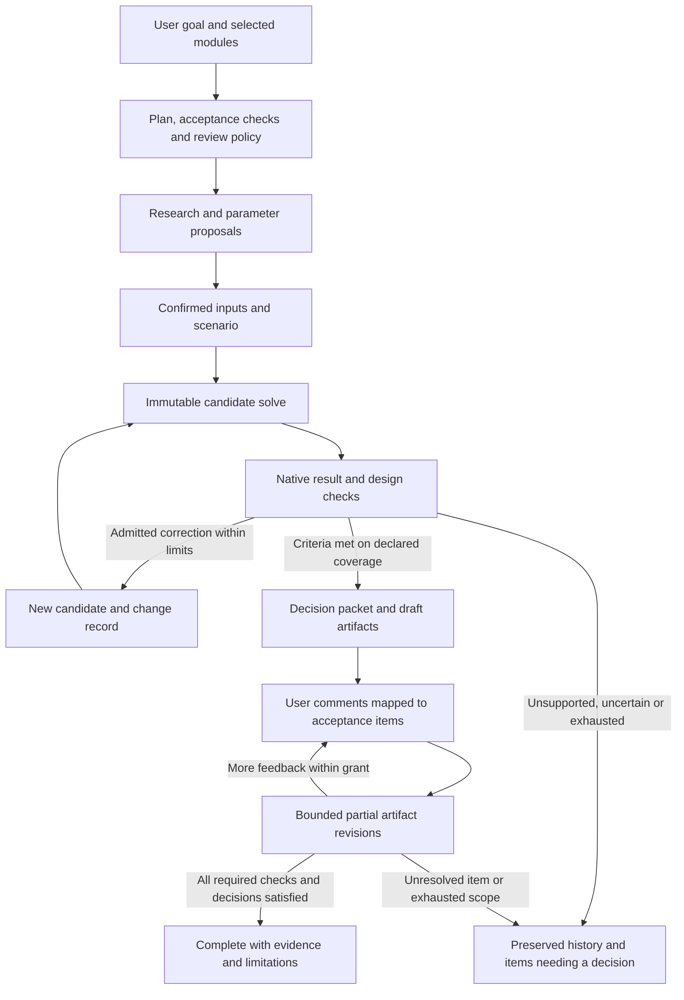

<!-- SPDX-License-Identifier: CC-BY-4.0 -->
# Coherent GridSpine workflow and review strategy

## One product flow

The companion converts user intent into a visible plan using the existing project/template/flow selection. One shared acceptance ledger survives stage transitions, background execution and feedback. The coordinator uses typed native tools; provider SDK choice is behind the existing protocol. There is no separate research/plausibility/report chatbot or new autonomous mode selector.

Convergence means the frozen native criteria and user objectives for the defined scenario are met. It does not mean the model is certified true, globally optimal or compliant in domains not evaluated. Both initially expensive and improved designs can be physically plausible; an economic target failure is not a physics defect. A run may correctly stop infeasible/unsupported/needs_user with every attempted correction documented.

## Five modules, backend capability authority

| User module | Existing logical card | Harness responsibility | Honest boundary |
|---|---|---|---|
| Energy/capacity expansion | capacity | Input/model readiness, economic/dispatch/design checks, native candidate solve and comparison | Weighted horizon/cost basis explicit; configured capacity is not automatically optimized capacity. |
| Grid/load flow | grid | Exact native source, network/ratings checks and configured code-assessment adapters | LOPF active power does not establish AC, contingency or dynamic compliance. |
| Reliability | reliability | Native ENS/LOLE/margin facts and supported native loops | Designed loss, statistical uncertainty, seed/sample and horizon definitions remain fixed. No missing-series certification. |
| Commercial | commercial | Tariff/contract/finance source basis, verified settlement/output adapters and reports | Currency/money-year/contract units, private PPA assumptions and unsupported engine facts stay explicit. |
| Control strategies | control | Route to configured native study/fidelity; preserve input/result provenance | No synthetic fast-transient/grid-forming conclusion from static flow or a language-model explanation. |

Use current flow_service/flow_scope verdicts and registered profile/adapter graph. Native `handoff`/assistant `hand-off` mappings remain explicit; they are delivery stages, not a sixth engineering module. UI ordering does not create engine dependencies. Optional modules can be omitted when backend prerequisites permit; required skipped work is not an empty pass.

## Template applicability

HH-09owns the exact profile table and capability resolution. Assess C&I/energy sites, data centers, IPPs, hydrogen/ammonia process hubs, island microgrids and mining/concentrator examples by their actual native template and configured stages. A template name never grants all five modules. Single-period versus staged planning remains a user/model horizon choice; phase support and native multi-period basis must be known before admission. Generic or missing adapters are explicit proposal/needs-configuration paths, not implicit automatic runs.

## Review effort and confidence

The client chooses policy on the existing plan/review card. A server-owned policy maps each acceptance item/action to evidence coverage, effect risk and any required explicit approval. Workers may explain uncertainty or recommend review; they cannot waive it or authorize their own result.

- Read-only inspection, deterministic checking and preauthorized copy-only typo/format revisions can proceed without additional clicks when the client policy explicitly covers them.
- Researched parameter values always require user confirmation; changing scenario demand, thresholds, model assumptions, grid codes, published findings or external commitments is not a formatting correction.
- A software-pass indicator names which checks/source/version passed. It is not the existing checked-answer badge unless the ordinary Assurance contract actually admitted it.
- Subjective acceptance, missing evidence, unconfigured domain fidelity or conflicting sources remain needs-user/unsupported/incomplete. The final packet lists all required parts, not only the successful ones.
- Required normal edit/export/publication cards remain enforced. No review waiver follows from model confidence, majority votes, a worker's pass text or hash integrity alone.

## Background and parallel operation

The server owns task leases, counters, checkpoints and exact native receipts. Activity is an observation surface; closing the browser does not cancel or approve work. Users may use other projects; same-project external edits retain native behavior and are detected as drift. Pause stops new admissions; cancellation does not prove an already submitted native job or model call had no effect/cost.

The coordinator can concurrently delegate two bounded read-only packet tasks initially. A third worker is a separately tested/configured extension within the same parent quota, not recursive uncontrolled spawning. Research/synthesis proposals can be joined, but the coordinator remains the sole native patch-commit authority. Conflicting or stale suggestions are retained and resolved through evidence/user review, not majority voting. Concurrent candidate branches need their own explicit native admission; workers do not mutate the shared live model.

## Product-target acceptance journey (capability-gated)

This target journey is not the initial unattended qualification: its template/reliability/report adapters must each be present and checked. Missing adapters produce explicit proposal/manual/needs-user paths without pretending completion. The initial real two-solve journey is the narrower HH-06/10 generic fixed-generator fixture.

A user selects the data-center template, Energy and Reliability, requests a fixed scenario comparison and a report/workbook. The plan lists native prerequisites, tunable design fields and immutable demand/connection/goals, then records every requested output. Read-only workers can research documented component ranges and summarize existing evidence in parallel. The user approves any proposed researched values. The coordinator submits an immutable candidate, evaluates native checks and frozen design goals, applies only permitted changes to new candidates and records before/after results/reasons. An unchanged failure signature stops rather than generating identical solves.

The user leaves to work elsewhere, returns to Activity and sees the exact candidates, checks, corrections, source/approval receipts and unresolved items. On feedback of three report comments and two Excel edits, each becomes an acceptance item on exact artifact versions. Supported preauthorized corrections produce new copies, preserve unrelated sections and run native/text/format checks. If one comment requires a scientific judgment or unsupported formula edit, the task remains needs_user with that item visible; it cannot report all five fixed. Completion occurs only after all required checks and user decisions are satisfied or explicitly revised by the user.
