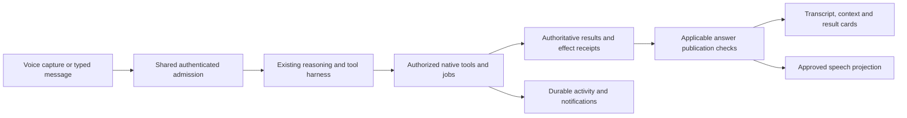

<!-- SPDX-FileCopyrightText: Contributors to PyPSA-Eur <https://github.com/pypsa/pypsa-eur> -->
<!-- SPDX-License-Identifier: CC-BY-4.0 -->

# Chat and Live design assessment against OpenAI Dots

Date: 2026-10-14, Europe/Oslo. AI-prepared assessment.
Application source: master `8617d3c061c05698ed41dbe2caa1ddf3dbf6b312`.
Status: recommendations only; no application implementation or deployment performed.

Accepted planning follow-up: [implementation specification](../chat-companion/spec.md), [phased plan](../../docs/superpowers/plans/2026-10-14-chat-companion-implementation.md) and [pending acceptance matrix](../chat-companion/test-plan.md), rebaselined to master `4ac218cc9`. The assessment findings retain the source baseline above.

This compares inspected application code with OpenAI's public product and API documentation. It includes no hands-on Dots session, current-app browser usability study, new test execution, or measured latency/cost comparison. Existing tests and contracts establish the intended seams; their existence is not a new execution result. No paid model/media calls or third-party messages were made.

## Assessment

The application already has a useful engineering assistant foundation: a persistent dock, a floating companion, shared tool admission, explicit confirmations, audited session history, durable tasks and run references, and a limited checked-answer pipeline. The main gaps relative to Dots are continuous audio, work that continues between conversations, and a clear user-facing view of activity, permissions and remembered context.

Use Dots' responsibility, activity and review patterns to build a persistent engineering work companion. Retain the application's native typed tools and authoritative run evidence. An engineering result needs a selected project/run/window, units and an established calculation basis regardless of how natural the conversation feels.

## Verified reference and comparison boundaries

- OpenAI describes Dots as persistent agents with cloud computers, connected apps and ongoing responsibilities. Messaging and voice are entry points into their work. This establishes the product benchmark; it does not disclose the proprietary implementation. [Introducing dots](https://openai.com/index/introducing-dots/).
- The documented profile exposes current, scheduled and completed work, task outputs and pause controls. Calls are user-initiated; the help page says Dots cannot initiate calls at launch. Individual delegated tasks have their own conversations and do not automatically receive every conversation with the dot. [Getting started](https://help.openai.com/en/articles/20001530-getting-started-with-your-dot).
- Custom Rules coexist with access permissions and required action review. Proactive research has read-only restrictions. The privacy FAQ currently says individual dot memories cannot be directly inspected or edited; removing a connection does not erase previously retained context. An inspectable, project-scoped memory UI would be a useful improvement for this application. [Privacy, security and safety FAQ](https://help.openai.com/en/articles/20001529-dots-privacy-security-and-safety-faqs).
- The public feature page emphasizes goals, feedback and work returned for review. It does not establish independently checked power-system calculations. Multi-dot collaboration and specialist offerings must be distinguished from generally shipped individual-dot capabilities. [Dots feature page](https://chatgpt.com/features/dots/).

The cited product pages do not establish a public Dots embedding API for this application. Implementation should use documented speech/Realtime interfaces and the existing harness. Product resemblance does not require adopting a particular reasoning model or adding generic computer control.

## What already exists

| Area | Inspected implementation | Remaining boundary |
| --- | --- | --- |
| Entry and presence | Compose, reviewed Dictate and Live; floating character/grid node; profile picker; reduced-motion handling | Live currently opens a text composer; presence does not establish microphone or playback state |
| Chat UI | Resizable persistent dock, uploads, choices, workflows, goal strip, confirmation/progress rows, checked-evidence cards | Activity and decisions remain scattered through chat; closed companion does not show ordinary answer text |
| Audio | Recorded/reviewed dictation, browser speech recognition and browser speech synthesis; generic bounded STT/TTS adapters | No inspected end-to-end continuous hosted media session or full duplex lifecycle |
| Continuity | Owner/project-scoped durable parent, discussed run references, generation checks and event-log reconstruction | No inspected always-on responsibility runner or in-app recurring-work scheduler |
| Delegation | Durable ordered tasks, ordinary solver jobs, bounded goal rounds and one network experiment case | Goal rounds run on the current stream; asynchronous follow-through, multiple-case comparison and uncertain-case recovery remain incomplete |
| Integrations | Admin-listed MCP servers, frozen session tool lists, bounded protocol, elevated confirmations for external writes | No complete user-facing connector onboarding, OAuth lifecycle or permission inventory |
| Reliability | Typed tools, ACL/locks, confirmation records, input/evidence identities, no-replay receipts, five checked profiles | Broader calculations, effects, artifacts and application-family journeys remain unestablished |

## Immediate UI/UX findings

### 1. Live communicates audio states that are not tied to audio

`AssistantDock` sets `listening` when Live opens. A chat stream ending triggers `speaking`, followed by a fixed timer returning to `listening`. These signals do not depend on a microphone track, speaker playback start/end, or a media connection. The Live composer is a text form, and its send uses `fromCard: true`; that path clears the dictated-voice flag used for existing spoken answers.

Implement an honest mode label immediately, such as **Chat here**, while continuous voice is unavailable. Real voice should expose **Start voice** only when its configured capability is available. Drive listening/speaking indicators from capture and playback events. Keep decorative idle motion visually distinct from recording.

Separate media state from work state. For example, **Microphone off · Solve running** is meaningful; a single four-value presence enum cannot describe both. Include connecting, muted, reconnecting, permission denied and ended media states, plus waiting for approval, running, completed and needs-review work states.

### 2. The closed companion needs a readable result

`CompanionOutcome` currently renders the current turn's download, while ordinary assistant sentences stay in the dock transcript. A user submitting text through Live cannot rely on its speaking animation as delivery of an answer.

Add a compact outcome card beside the companion: concise answer, current project/run, declared checking status, and **Open result**, **View evidence**, **Download** and **Open transcript** when applicable. Unsupported checks must be described as unavailable; an ordinary generated answer must not acquire a universal verified badge. A shorter checked summary needs its own validated projection or receipt; it must not be a fresh unverified paraphrase of a checked answer.

Keep both captions and text available when audio is muted, fails or is interrupted. Do not clear the only useful answer with a decorative timeout.

### 3. Context and work should be visible outside transcript prose

Add a context strip showing project, current/historical run, time window and comparison baseline. Selecting a discussed historical run must not restore historical inputs into the live network.

Add an **Activity** view backed by authoritative records: **Running**, **Needs you**, **Scheduled** and **Completed**, with links into the relevant project and outputs. Keep distinct controls for stopping speech, ending voice, pausing future agent work, cancelling an experiment's future advancement and requesting actual job cancellation. Explain which operation each affects.

### 4. Results walkthroughs should follow evidence and displayed data

`liveWalk.ts` cycles a predefined tab list using pacing delays. The same Live request can also be forwarded to the model, producing two potential navigation controllers. The local helper is useful scaffolding, but it does not prove the requested run/window's data has loaded or a numerical finding has been checked.

Use one authoritative walkthrough plan: eligible tabs, selected evidence and findings, source-bound navigation actions, and matching displayed-data acknowledgments. Advance after the view is ready; newer manual navigation wins. Show unavailable results explicitly and never substitute the current run for a missing historical section.

### 5. Improve discoverability and accessibility without replacing the launcher

Retain the domain-specific grid companion and dock. Add readable action labels, an always-discoverable touch entry, visible microphone and speaker controls, and explicit connection/recording status. Current small text and hover-revealed actions warrant narrow-viewport and coarse-pointer testing; the source review alone does not prove an accessibility failure.

Use keyboard focus, restrained live-region announcements, reduced motion, adequate contrast and comfortable touch targets. Test overlap with map controls, dialogs and confirmation cards. Optional name/avatar/voice preferences are lower priority than truthful state and result visibility.

## Feature gaps and implementation proposals

| Priority | Dots reference pattern | UX/UI implementation | Backend implementation and reuse |
| --- | --- | --- | --- |
| P0 | Conversation as a useful entry point | Honest Live availability; real mic/playback indicators; persistent text fallback | Capability endpoint and separate media/work state; use actual media events, not timers |
| P0 | Work returned for review | Compact result and evidence card in the closed companion | Project/run/window-bound result projection; reuse answer receipts and authenticated file delivery |
| P0 | Visible boundaries and review | Context strip; exact old/new/unit preview; explain a pending decision | Reuse catalogue tiers, ACL/locks and confirmation records; project/generation/effect-bound tokens and deterministic policy floors |
| P1 | Inspectable ongoing work | Activity drawer and Needs-you inbox; per-job progress and outputs | Common read model over tasks, job adapters and evidence; durable snapshots, cursor recovery and scoped notifications |
| P1 | Calls alongside work | Start voice, captions, mute speaker/mic, interrupt, end and reconnect | Streaming STT, end-of-turn detection, bounded TTS, cancellation and playback cursor; owner/thread/project/generation-bound credentials |
| P1 | Responsibility between conversations | Delegate a bounded study; leave and return to its actual status | Worker-driven task advancement, durable leases/reservations, budgets, failure policy and no-replay reconciliation; extend existing one-case engine |
| P2 | Recurring and proactive work | Opt-in schedules and an attention inbox with meaningful updates | Event/clock triggers, read-only watchers, deduplicated alerts, IANA time zones, expiry and quiet hours; no unauthorized solves or sends |
| P2 | Remembered preferences | Inspect/edit/delete project-scoped preferences and explicit context sharing | Separate approved preferences, engineering assumptions and immutable evidence; retain provenance and recheck ACLs on every use |
| P2 | Connected apps and permission controls | Connection status, allowed actions, project scope, reconnect/revoke | Build on admin MCP admission; credential broker/OAuth only where supported; preserve external-write confirmation floors |
| P3 | Work across channels and computers | Responsive remote activity/approval views; explicit handoff | Actor/channel authentication, scoped task context, project pinning and notification authority; hosted isolation before remote delegation |

P0 means the first product fixes; P1 means the next functional increment; P2/P3 are expansion. These are relative scopes, not promised delivery dates.

## Backend architecture

Keep one reasoning/tool harness. A speech interface should submit a finalized, deduplicated utterance through the same admission path as typed chat. It must not independently execute tools or announce numerical results outside publication checks.

### Media path

Extend the existing STT/TTS provider interfaces to streaming events and connect them to the durable parent and utterance generation. Keep partial transcripts as captions. Clarify ambiguous engineering quantities before admitting a consequential action. Barge-in stops playback first; it does not undo completed effects or cancel a solver automatically. Record what was played so a follow-up does not assume the user heard the remainder.

OpenAI documents browser WebRTC and server WebSocket transcription paths. Current `gpt-live-transcribe` documentation requires application-controlled turn commits and does not support server/semantic VAD for that model; compatible models have different turn-detection support. Select a provider/model deliberately and validate its actual contract. [Realtime transcription](https://developers.openai.com/api/docs/guides/realtime-transcription), [VAD](https://developers.openai.com/api/docs/guides/realtime-vad).

A browser credential must be short-lived and scoped; the application's server remains the tool authority. OpenAI documents server-minted ephemeral credentials for WebRTC. A provider credential alone does not enforce this application's project or action permissions. [WebRTC](https://developers.openai.com/api/docs/guides/voice-webrtc).

Implement parent reservations for audio duration, STT/TTS units, model usage and jobs. Unknown or late usage keeps a conservative reservation. Settle each usage event once; reconnect must not reset caps. Validate mocks before separately authorized paid media/device probes. Existing latency targets are acceptance goals, not measurements from this assessment.

### Responsibility path

Separate a durable work item from its transient chat/media episode. Reuse task and experiment records, but add an authoritative runner that can observe a completed job, checkpoint the next step and issue a Needs-you item without a browser keeping an SSE stream open. A persisted plan alone is not execution authority.

Pin each work item to actor, project, input/evidence identities, allowed operations and budgets. Start with one authoritative application worker and bounded isolated cases. Cross-project concurrency requires isolated contexts and explicit resource admission; distributed execution requires a separate lease/transaction design.

Complete uncertain-effect reconciliation before enabling unattended replay or retries. Verify the originating worker and actual effect receipt; a timeout is not proof that nothing happened. Multiple-case comparison must match source/window/units/basis and preserve missing and failed cases.

### Rules and memory

Present the effective permissions already enforced by the server. Initially allow additional restrictions and scoped review preferences. Do not silently introduce permissive auto-approval for external tools: current MCP writes require confirmation in Expert as well as Guided. Saved preferences or documents cannot grant tool authority.

Make preferences inspectable, correctable and deletable. Engineering assumptions need explicit approval and provenance; remembered conversational preferences are not a source for missing technical inputs. Keep project contexts separated and offer an explicit, bounded handoff when sharing context. Disconnecting an integration and deleting retained data are separate controls.

## Recommended delivery sequence

1. **Truthful companion UI:** honest mode labels, actual-state indicators, concise outcomes, source strip and usable fallback. No new vendor connection is required.
2. **Observable durable work:** unified Activity/Needs-you view, correct job controls, common monitoring recovery, two-case comparison and uncertain-effect reconciliation. This extends the existing remaining-work plan.
3. **Mocked continuous voice, then hosted proof:** separate lifecycle states, captions and barge-in, budgets, scoped sessions, source-bound approved speech, reconnect and complete cleanup. Connect a chosen hosted adapter only after contract tests and setup; request separately bounded live-probe authorization when needed.
4. **Scoped ongoing responsibilities:** event-driven notifications and opt-in schedules, inspectable preferences and connector administration. Add remote channels/computer delegation after hosted isolation and ownership tests.

Expand checked profiles and artifact guards alongside the relevant domain flows. Existing five profiles do not certify all result tabs, all charts/reports or total engineering economics. Independent domain review and representative real-use calibration remain pending by owner choice.

## Acceptance scenarios

| Scenario | Required outcome |
| --- | --- |
| Open Live without a media session | No false recording/listening indicator; useful in-page text and capability explanation |
| Answer with the dock closed | Readable current answer/outcome with correct source/check status; authenticated delivery and open-transcript route |
| Ask for key results from an old run | Exact recorded run/window; unavailable sections remain unavailable; the live network is unchanged |
| Say an ambiguous capacity or cost | Clarify quantity/unit; do not guess an engineering input or use a transcript partial as approval |
| Interrupt spoken output | Playback stops promptly; completed work persists; heard-text position is recorded |
| Deny or expire a confirmation | No effect; visible reason; no queued write proceeds unexpectedly |
| Close the dock or reconnect during a solve | Job persists; activity resumes from authoritative state; no duplicate submission |
| Timeout after a possible write | Needs review/uncertain; never silently reset to unexecuted or offer unsafe replay |
| Switch project/provider or receive a late callback | Old media/result/navigation events cannot update the new context; stale approvals refuse |
| Pause a watcher or exceed a budget | No new admitted work; existing jobs are identified truthfully; notifications remain bounded |
| External document says to send data | It provides no authority; effective tool permissions and ordinary confirmations still apply |
| Touch/keyboard/permission-denied/autoplay-blocked | Controls remain discoverable; focus and captions usable; no leaked mic tracks, sockets or playback |

Use independent tiny-network numerical fixtures, public authenticated harness paths, mocked audio events and browser tests. Then measure real devices, languages, network conditions and cost with explicit identifiers. Full application coverage remains false until the required family journeys and remaining release gates have evidence.

## Source evidence index

- [AssistantDock](../../pypsa-gui/frontend/src/components/AssistantDock.tsx): presence timing at lines 84–103; Live submit/controller at 110 onward; listening entry at 321–329.
- [CompanionLauncher](../../pypsa-gui/frontend/src/components/CompanionLauncher.tsx): typed Live form at 97–140; action/profile and reduced-motion behavior.
- [CompanionOutcome](../../pypsa-gui/frontend/src/components/CompanionOutcome.tsx): download-only closed outcome at 26–43.
- [ChatPanel](../../pypsa-gui/frontend/src/components/ChatPanel.tsx): approved speech publication at 2418–2439; card/Live sends clear dictated voice at 2548; common Live admission at 2724 onward.
- [Live walkthrough](../../pypsa-gui/frontend/src/components/liveWalk.ts): predefined tabs and timed navigation.
- [Speech adapters](../../pypsa-gui/backend/harness/providers/live_media.py): bounded injected HTTP STT/TTS contracts.
- [Durable conversation](../../pypsa-gui/backend/services/durable_conversation.py), [tasks](../../pypsa-gui/backend/services/assistant_tasks.py), [job adapters](../../pypsa-gui/backend/harness/job_adapters.py): existing state/recovery and job seams.
- [Goal rounds](../../pypsa-gui/backend/harness/goals.py), [harness contract](../../pypsa-gui/backend/harness/README.md): current-stream bounded goals, event-log authority and five checked profiles.
- [MCP client](../../pypsa-gui/backend/harness/mcp_client.py): existing admin integration and mandatory external-write confirmations.
- [Experiment execution](../../pypsa-gui/backend/harness/experiment_execution.py): one-network-case admission and durable effect receipts.
- [Coverage contract](application-coverage.md), [remaining-work plan](../../docs/superpowers/plans/2026-10-13-assistant-remaining-work.md): incomplete journeys and staged implementation scope. Their older baseline counts and completed prerequisite milestones require source reconciliation.
