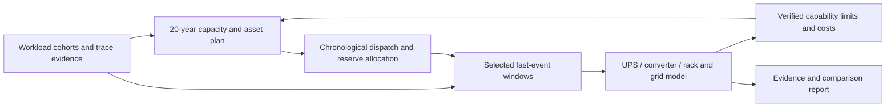

# GridSpine grid-to-rack assessment for data centres

Assessed 21 October 2026 against master `525b2587a1db0ebbb9ee3cfbc8adc0dc9c278a7c`. **Revised recommendation after workflow-fit research: build a small native rapid-load/reserve capability in the existing flow; defer external engine integrations.** Full grid-to-rack modeling is technically feasible, but that does not establish that a new toolchain belongs in the normal user journey. This assessment implements no runtime engine and makes no equipment or grid-compliance certification claim.

The product should answer one connected question: **what campus assets, power architecture and controls serve the intended computing workload, survive its fast disturbances, and remain affordable and adequate over a 20-year operating plan?** Long-term capacity planning and millisecond electrical behavior need linked models at different resolutions, rather than a single 20-year simulation at millisecond timesteps.

**Start with the [revised fit decision](../../.scratch/grid-to-rack/05-WORKFLOW-FIT-DECISION.md) and [integrated journey](../../.scratch/grid-to-rack/06-INTEGRATED-JOURNEY.md).** They supersede the earlier suggestion to make OpenG2G/DPsim the next integrations. The deeper review examined actual Guided/Expert code and input ownership, primary engineering/model guidance, source data needs and user decisions. Six existing frontend suites passed 76 component/helper tests; no new-UI usability or physical-engine validation is claimed.

## Existing foundation and principal gaps

| Layer | Current implementation | What needs adding |
| --- | --- | --- |
| Capacity / energy planning | PyPSA data-centre templates, investment periods, staged IT growth and energization, assets, costs and adequacy studies | Joint workload-growth/architecture scenarios and dynamically feasible power/SOC reserve constraints; a validated 20-year scenario is not proved by the current three-period example. |
| AI workload | Opt-in assumed training model: hourly demand plus step/checkpoint/oscillation envelope and rack-density metadata | Time-stamped traces/cohorts, synchronisation and performance/deadline constraints; rack/IT/UPS/PoC measurement planes. |
| Campus grid | pandapower-based load flow, reactive compensation including STATCOM sizing, short circuit, island analysis | Trace-driven coupled P/Q/voltage assessment and appropriate multi-bus dynamics. Static ratings are not dynamic control capability. |
| Frequency and UPS | Native single-bus frequency screen, GFM/GFL behavior, governors, limits and simplified UPS transfer/walk-in | DC-link voltage, converter inner loops/PLL/current saturation, detailed UPS modes, rack undervoltage and protection. Millisecond timestep alone does not provide these equations. |
| Planning feedback | Existing heuristic island-frequency cuts and ordinary apply controls | Source-bound fast-service requirements/reserve envelopes and limited-validity feedback, with clear distinction between heuristic and proven constraints. |
| Evidence | Source tagging, checked-answer/result evidence, reports and handoffs | Cross-timescale receipts tying the exact workload, topology, dispatch initial state, controller and engine to the result. |

See the [code-backed gap assessment](../../.scratch/grid-to-rack/01-CURRENT-GAPS.md) and [native evidence inventory](../../.scratch/grid-to-rack/native-evidence.json). Existing frequency code explicitly excludes voltage dynamics, inter-unit oscillation and converter current-limit dynamics. Its callable event seam can be reused for frequency screening; it must retain that label.

## Connected modeling design

In each fast window, model the physical path **grid → substation/campus distribution → UPS rectifier/DC link/storage → inverter/PDU or DC distribution → rack/server load**. Cooling has a separate slower electrical/thermal branch. AC double-conversion, MV UPS and 800 VDC/SST designs are different topologies, not equivalent efficiency labels.

Use representative operational years, chronological stress periods and selected event windows. Transfer asset vintages, topology, grid strength, dispatch, SOC, reserved headroom and controller settings into the fast model. Return only justified capability bounds, costs and limitations to planning. Never reconstruct a measured millisecond waveform from an hourly mean, or reset the same battery SOC independently for every service.

**Power and energy are different design constraints.** An ideal 20 MW buffer for 100 ms exchanges only about 0.56kWh, yet requires 20 MW of power capability. This is an illustrative arithmetic lower bound, not a battery design. Converter response, local capacitance, voltage limits, losses, repeated events, backup reserves and recharge can dominate. A STATCOM supplies reactive support; active-power smoothing requires an energy source/sink or changing the workload.

## Revised integration decisions

| Candidate | Revised disposition | Reason |
| --- | --- | --- |
| [OpenG2G](https://github.com/gpu2grid/openg2g) | Defer; retain as workload/control R&D | Its training synthesis, inference benchmarks and OpenDSS power flow do not close the rack/UPS transient gap. A second topology/coordinator and performance model need explicit justification. |
| [DPsim](https://github.com/sogno-platform/dpsim) | Defer bundled integration; conditional specialist candidate | Requires source-backed device/control parameters, a validated physical chain, initialization and deployment review. No default engine selected. |
| [Zeus](https://github.com/ml-energy/zeus) / [DCGM](https://github.com/NVIDIA/DCGM) | Optional external acquisition; generic measured-trace import | No baseline runtime/GPU requirement. Measurement plane, bandwidth and API/device support must be verified. |
| [HELICS](https://github.com/GMLC-TDC/HELICS) | Do not integrate now | Current staged artifact exchange does not need a second orchestration layer; reconsider only for a demonstrated concurrent closed loop. |
| [Vessim](https://github.com/dos-group/vessim) | Leave outside the current planning product | Substantial overlap with native planning/dispatch/SOC/results. Useful external research alternative. |
| [Modelica Buildings](https://simulationresearch.lbl.gov/modelica/) | Conditional later thermal scope | Add only when source-backed cooling/thermal detail answers a material energy, control or availability question. |

Dynawo, OpenIPSL and PowerDynamics.jl remain specialist research alternatives. ANDES remains parked under Q4. Public PSCAD models can inform benchmarks/model structure subject to runtime/reuse constraints. No additional default grid backend, cell-aging engine or full rack digital twin is proposed. See the [source assessment](../../.scratch/grid-to-rack/03-OPEN-SOURCE.md) and [tool-by-tool fit decision](../../.scratch/grid-to-rack/05-WORKFLOW-FIT-DECISION.md).

## Recommended first implementation

Extend the existing data-centre example with **one existing assumed envelope or authorized event trace, one growth plan and an optional current-versus-limited-UPS/storage screen**. Inputs stay on Loads & demand, Connection & grid and Assets & sizing; study requests stay in Scenarios. **Control Strategy → Response to rapid load changes** is the assessment and primary result home, with Grid and Reliability summaries linked to the same result. Use a compatible electrical operating point for a grid-coupled study; a standalone power/energy screen declares its baseline and exclusions. Load flow alone establishes no transient response, and a successful rapid event establishes no annual LOLE/EUE. No extra top-level section, duplicate asset editor, engine picker or external account. Coordinated compute-performance control is deferred until its distinct data/model gates pass.

Report only supported PoC/reserve/energy outcomes with their assumption and limit basis. Native planner enforcement of a required reserve must be independently implemented/verified before claiming the capacity optimum includes it. Detailed voltage, harmonics and compliance stay **not established** at screening depth. An actual operator study requirement remains visible and may require specialist analysis; a successful preliminary screen cannot hide it.

The [architecture](../../.scratch/grid-to-rack/02-ARCHITECTURE.md) remains a future capability map. The [engineering test matrix](../../.scratch/grid-to-rack/04-IMPLEMENTATION-TESTS.md), [workflow-fit decision](../../.scratch/grid-to-rack/05-WORKFLOW-FIT-DECISION.md), [journey/UX acceptance tasks](../../.scratch/grid-to-rack/06-INTEGRATED-JOURNEY.md) and [handoff](../../.scratch/grid-to-rack/HANDOFF.md) define continuation. Independent domain review, measured hardware calibration and representative usability/real-use acceptance remain pending.
