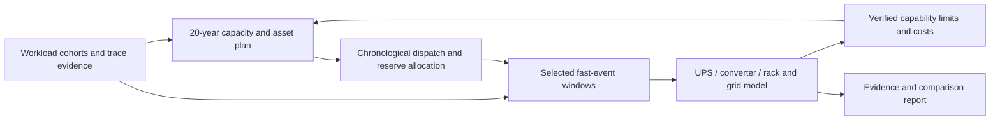

# GridSpine grid-to-rack assessment for data centres

Assessed 21 October 2026 against master `525b2587a1db0ebbb9ee3cfbc8adc0dc9c278a7c`. **Feasible as an extension of the existing framework, but not already a complete grid-to-rack simulator.** The recommended next scope is a trace-and-buffer screening prototype, followed by one bounded electrical-transient engine evaluation. This assessment implements no runtime engine and makes no equipment or grid-compliance certification claim.

The product should answer one connected question: **what campus assets, power architecture and controls serve the intended computing workload, survive its fast disturbances, and remain affordable and adequate over a 20-year operating plan?** Long-term capacity planning and millisecond electrical behavior need linked models at different resolutions, rather than a single 20-year simulation at millisecond timesteps.

## Existing foundation and principal gaps

| Layer | Current implementation | What needs adding |
| --- | --- | --- |
| Capacity / energy planning | PyPSA data-centre templates, investment periods, staged IT growth and energization, assets, costs and adequacy studies | Joint workload-growth/architecture scenarios and dynamically feasible power/SOC reserve constraints; a validated 20-year scenario is not proved by the current three-period example. |
| AI workload | Opt-in assumed training model: hourly demand plus step/checkpoint/oscillation envelope and rack-density metadata | Time-stamped traces/cohorts, synchronisation and performance/deadline constraints; rack/IT/UPS/PoC measurement planes. |
| Campus grid | pandapower-based load flow, reactive compensation including STATCOM sizing, short circuit, island analysis | Trace-driven coupled P/Q/voltage assessment and appropriate multi-bus dynamics. Static ratings are not dynamic control capability. |
| Frequency and UPS | Native single-bus frequency screen, GFM/GFL behavior, governors, limits and simplified UPS transfer/walk-in | DC-link voltage, converter inner loops/PLL/current saturation, detailed UPS modes, rack undervoltage and protection. Millisecond timestep alone does not provide these equations. |
| Planning feedback | Existing heuristic island-frequency cuts and ordinary apply controls | Source-bound fast-service requirements/reserve envelopes and limited-validity feedback, with clear distinction between heuristic and proven constraints. |
| Evidence | Source tagging, checked-answer/result evidence, reports and handoffs | Cross-timescale receipts tying the exact workload, topology, dispatch initial state, controller and engine to the result. |

See the [code-backed gap assessment](../../.scratch/grid-to-rack/01-CURRENT-GAPS.md) and [native evidence inventory](../../.scratch/grid-to-rack/native-evidence.json). Existing frequency code explicitly excludes voltage dynamics, inter-unit oscillation and converter current-limit dynamics. Its callable event seam can be reused for frequency screening; it must retain that label.

## Connected modeling design

In each fast window, model the physical path **grid → substation/campus distribution → UPS rectifier/DC link/storage → inverter/PDU or DC distribution → rack/server load**. Cooling has a separate slower electrical/thermal branch. AC double-conversion, MV UPS and 800 VDC/SST designs are different topologies, not equivalent efficiency labels.

Use representative operational years, chronological stress periods and selected event windows. Transfer asset vintages, topology, grid strength, dispatch, SOC, reserved headroom and controller settings into the fast model. Return only justified capability bounds, costs and limitations to planning. Never reconstruct a measured millisecond waveform from an hourly mean, or reset the same battery SOC independently for every service.

**Power and energy are different design constraints.** An ideal 20 MW buffer for 100 ms exchanges only about 0.56kWh, yet requires 20 MW of power capability. This is an illustrative arithmetic lower bound, not a battery design. Converter response, local capacitance, voltage limits, losses, repeated events, backup reserves and recharge can dominate. A STATCOM supplies reactive support; active-power smoothing requires an energy source/sink or changing the workload.

## Open-source shortlist

| Candidate | Recommended role | Important boundary |
| --- | --- | --- |
| [OpenG2G](https://github.com/gpu2grid/openg2g) | First optional workload/grid coordination adapter to evaluate | Source inspection confirms multi-rate coordination, synthetic training overlays and OpenDSS power-flow coupling. This is not a ready UPS/rack EMT solver. Example inference data is gated; no download/account/model calls were made. |
| [DPsim](https://github.com/sogno-platform/dpsim) | First detailed electrical-engine spike | EMT/dynamic-phasor solver with converter-model building blocks; actual UPS/DC-link/rack chain and control validation remain development work. MPL2.0 and native dependencies require deployment review. |
| [Zeus](https://github.com/ml-energy/zeus) / [DCGM](https://github.com/NVIDIA/DCGM) | Optional measured workload-power adapters | GPU telemetry is not rack/PoC power, and polling faster does not prove sensor bandwidth. NVML's common power call averages over 1 s on many architectures; actual instantaneous fields/support must be verified. |
| [HELICS](https://github.com/GMLC-TDC/HELICS) | Later cross-process multi-rate coordination if needed | An orchestrator, not an electrical solver or a guarantee of stable coupling. Start with deterministic artifact exchange. |
| [Vessim](https://github.com/dos-group/vessim) | Optional software-in-the-loop energy/control experiments | Useful energy-system framework, overlaps existing planning/dispatch. Current source makes Mosaik coupling optional; no need to replace the native stack or require a second orchestrator. |
| [Modelica Buildings](https://simulationresearch.lbl.gov/modelica/) | Later cooling/thermal and loss-model refinement | Useful data-centre cooling models; does not provide an automatically calibrated fast rack-power model. |

Dynawo, OpenIPSL and PowerDynamics.jl are alternatives to evaluate if the first electrical spike fails its requirements, not simultaneous new dependencies. ANDES remains parked under the repository's existing Q4 decision; this assessment does not reopen that approval. Public PSCAD data-centre models are useful benchmark/model-structure references, but a downloadable model is not an open-source runtime or permission to redistribute it commercially. See the [full engine/source assessment](../../.scratch/grid-to-rack/03-OPEN-SOURCE.md).

## Recommended first implementation

Extend the existing data-centre example with **one assumed or authorized measured workload, one growth plan and three optional mitigation cases**: no fast mitigation, local UPS/storage smoothing, and coordinated workload/storage control. Reuse existing native cases and ordinary approvals. Start offline; provide a synthetic-data route that needs no gated inference dataset or GPU account.

Report PoC ramp and residual oscillation, buffer peak MW/energy/SOC, available backup reserve, energy/loss/cost differences and any modeled workload-performance penalty. In screening mode, report converter/rack voltage, harmonics and detailed compliance as **not established**. Add one calibrated electrical window before publishing those detailed results.

The [architecture/specification](../../.scratch/grid-to-rack/02-ARCHITECTURE.md), [implementation sequence and test matrix](../../.scratch/grid-to-rack/04-IMPLEMENTATION-TESTS.md), and [handoff](../../.scratch/grid-to-rack/HANDOFF.md) make this portable to another agent. Independent domain review, measured hardware calibration and real-use acceptance remain pending.
