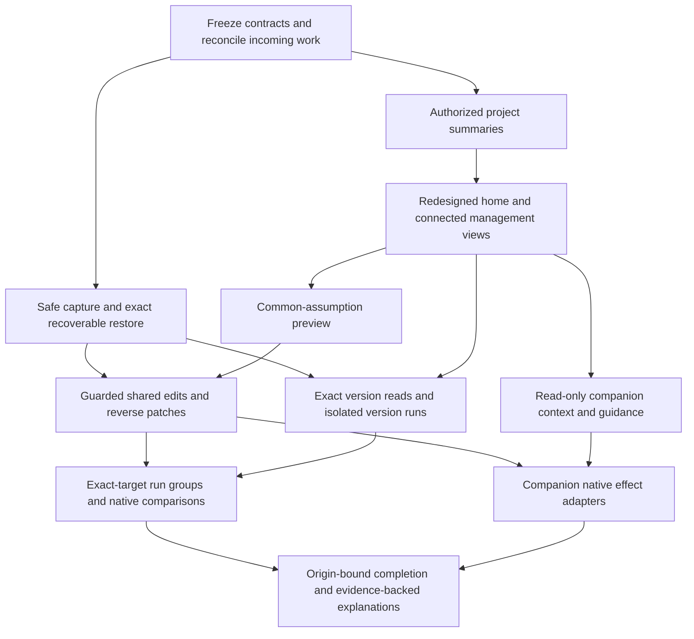

# GridSpine project management redesign and implementation plan

Source baseline: master `a68db6cfcf254df17a5b0d96da7a4c995f26423f`, 21 October 2026. This is a **specifications and audit PR covering the entire project-management implementation, including the chatbot**, not a runtime feature release or independent approval.

The proposal combines a modern project home/overview, connected variants/runs/versions/files/access, safe checkpoint and restore, shared assumptions across selected variants, native comparison and one context-aware GridSpine companion. Model parameterization remains in the existing owning Guided/Expert sections.

**Start with the [concrete implementation plan](../../.scratch/project-management-redesign/04-IMPLEMENTATION-PLAN.md): 15 bounded delivery packages, 116 required acceptance cases and 9 domain contexts.** Every case has an implementation owner beyond the aggregate gate, and every audited feature maps to delivery packages. These are proposed acceptance requirements, not 116 implemented or passing new tests.

| Read | Purpose |
| --- | --- |
| [Feature audit](../../.scratch/project-management-redesign/01-MASTER-FEATURE-AUDIT.md) | 24 current features assessed against actual specs and proposed expectations; source-inspected vs reproduced findings separated. |
| [UX/UI concept](../../.scratch/project-management-redesign/README.md) | Compact Resume, searchable Cards/List home, coherent project overview, cool neutral themes/coral accents and five management views. |
| [Shared assumptions](../../.scratch/project-management-redesign/02-SHARED-ASSUMPTIONS-SPEC.md) | Exact variant targets, effective values, old→new preview, preserved differences, guarded apply/revert and separate runs; 20 acceptance cases. |
| [Chatbot integration](../../.scratch/project-management-redesign/03-CHATBOT-INTEGRATION-SPEC.md) | One companion, explicit project/variant/source context, common native actions/approvals, bounded evidence and continuations; 26 acceptance cases. |
| [Implementation plan](../../.scratch/project-management-redesign/04-IMPLEMENTATION-PLAN.md) | Dependencies, existing/proposed code paths, test files to add, independent acceptance oracles, domain journeys and release gates. |
| [API and UI contracts](../../.scratch/project-management-redesign/05-API-AND-UX-CONTRACTS.md) | Proposed routes/data/receipts, screen actions, responsive/accessibility behavior and migration/portability policy. |
| [Structured plan](../../.scratch/project-management-redesign/implementation-plan.json) | Machine-readable packages, test matrix and feature mapping for another agent. |
| [Validation](../../.scratch/project-management-redesign/VALIDATION.json) and [handoff](../../.scratch/project-management-redesign/HANDOFF.md) | Exact baseline test evidence, source pins, limitations and continuation instructions. |

## First three AI priorities

[Focused code assessment and cost/usefulness design](../../.scratch/project-management-redesign/06-AI-PRIORITIES-AND-COST-SPEC.md): **1. Explain what to do next; 2. Explain these results; 3. Suggest useful variants.** Reuse one existing configured provider, bounded evidence/outputs and native deterministic facts; avoid always-on multi-model review and automatic solves. ROI is not yet measured. The focused current-master snapshot `87546ef5d184a9b20c80a65e2164f7fac0930f15` passed 120 existing backend tests; no new AI feature, paid call or live ROI benchmark was executed. The 116 cases comprise the original 98 plus 18 targeted ROI/cost/source tests.

## Findings that change delivery order

The baseline has substantial working project/scenario/queue/comparison/access infrastructure. Existing targeted tests passed: 382 project/persistence backend tests, 187 execution/comparison backend tests, 224 frontend component/helper tests and 74 standalone save/load QA checks. This is historical audit evidence, not current runtime-implementation CI or complete browser coverage.

Three new authenticated HTTP restore expectations **failed**: automatic pre-restore protection omits unsaved live edits; settings created after a checkpoint can survive restoring it; uploads added after a checkpoint without uploads/ can also survive. The spec therefore places dirty capture, a declared presence/hash manifest and recoverable restore before promising dependable rollback. The audit probes remain explicitly failing evidence, not skipped/relaxed production tests.

Other source findings include creation time labelled Updated, a general comparison rail opened without the clicked saved-version ID, newest version labelled current, insufficient global Best objective ranking context and outdated Workspace architecture/lock text.

## Delivery sequence

Existing independent scenario copies stay independent. A shared-assumption update is explicit and target-bound; it is not automatic inheritance. The proposed eight-target editor does not raise the current four-new-case sensitivity tool cap. Initial shared edits admit one defined scalar family and expand only with native unit/basis/writer/read-back contracts and tests.

No new solver, paid model/media call, live hardware control, deployment, reviewer contact or full-coverage/compliance claim is included. Independent review, representative usability, hosted voice testing and real-use calibration remain pending. Runtime implementation and safe-restore fixes are not performed by this specifications PR.
