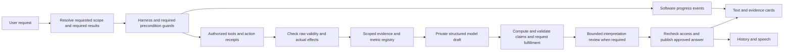

<!-- SPDX-FileCopyrightText: Contributors to PyPSA-Eur <https://github.com/pypsa/pypsa-eur> -->
<!-- SPDX-License-Identifier: CC-BY-4.0 -->

# Evidence-backed assistant: implementation and TDD plan

Status: original design independently reviewed; reliability revision proposed and
pending independent review. First publication/static-input pilot implemented
locally; no implementation review or release approval is claimed. See
[implementation status](../../../.scratch/assistant-assurance/implementation-status.md).
AI-generated plan against master `d43809ae`; dictation PR 106 is merged.
Contract: [spec](../../../.scratch/assistant-assurance/spec.md).
Acceptance: [test matrix](../../../.scratch/assistant-assurance/test-plan.md).
Continuation: [handoff](../../../.scratch/assistant-assurance/session-handoff.md).
Independent review: [assessment](../assessments/2026-10-10-assistant-answer-assurance-review.md).
Current source audit: [reliability assessment](../assessments/2026-10-10-assistant-assurance-reliability.md).
Additional requirements: [reliability contract](../../../.scratch/assistant-assurance/reliability-contract.md).

## Recommendation

Put a vendor-neutral publication gate in the harness. Deterministic validators
establish data/action identity, arithmetic, scope, provenance and permissions;
server-rendered factual blocks prevent the model changing checked numbers or
statuses in prose. A bounded optional reviewer checks interpretations and
presentation, with explicit limits. Show source-linked evidence cards and real
execution/check events, not hidden model reasoning. The same approved answer feeds
typed chat, history, reports and eventual voice. Never promise error-free models.

## Dependencies and ownership

Check both the user's requested scope and the facts, then validate the domain
calculation and actual effects. Evidence matching alone can approve an accurate
number for the wrong question or reproduce a bad legacy aggregate. The reliability
contract is part of phase completion; the earlier review covers the original
design only. Freeze added schemas before adding acceptance fixtures.

Reuse existing tool dispatch/providers/confirmation/task semantics, auth/CSRF,
result APIs, chart/delivery services and report audit. Add neutral contracts under
`harness/assurance/` and shared evidence/artifact adapters in `services/`;
provider-specific optimizations remain in `harness/providers/`. Preserve aliases
and the closed SSE vocabulary; intentional new events require backend/frontend
schema and golden-contract changes together, no arbitrary payload escape hatch.

[Live-voice issue 06](../../../.scratch/live-voice/issues/06-run-evidence-and-context.md)
owns immutable run records and shared run tools. Issue 09 owns durable conversation,
issue 11 nonblocking jobs, and issue 03 the assistant UI. Assurance supplies their
validation/publication/progress projection, not parallel stores or session systems.
Pilot evidence can use a scoped captured fixture/current dataset; historical and
restart guarantees cannot release until issue 06/09 dependencies are implemented.

## Phases and required gates

| Phase / ticket | Delivered behavior | Required tests before green | Dependency / completion gate |
| --- | --- | --- | --- |
| P0 / [01](../../../.scratch/assistant-assurance/issues/01-output-contract-and-coverage.md) | Versioned output/draft/decision/receipt contracts; exhaustive family/channel inventory | A0 contracts and source coverage | Existing source inventory; classify every tool/output; unknown sources cannot appear checked |
| P1 / [02](../../../.scratch/assistant-assurance/issues/02-evidence-identity-and-access.md) | Full pre-truncation capture, scoped evidence, immutable run adapters, typed validity | A1 ACL/integrity/freshness/pagination and independent domain fixtures | Issue 06 for retained runs; no new run store; missing provenance explicitly unavailable |
| P2 / [03](../../../.scratch/assistant-assurance/issues/03-answer-publication-gate.md) | No private text/thinking leakage; constrained claims, rendering, repair/fallback; basic approved-only UI/history/summaries/exports/current TTS | A2 fragmented streams, prose contradictions, units/arithmetic, failures and current public projections | P0/P1; durable answer+receipt before any public output; unsupported action outcomes withheld pending P3; no repeated tools |
| P3 / [04](../../../.scratch/assistant-assurance/issues/04-action-and-job-outcomes.md) | Honest execution/progress status and postcondition receipts | A3 queued/partial/denied/uncertain/cancel/job lifecycle tests | P0/P1; integrate live-voice issue 11 for nonblocking work |
| P4 / [05](../../../.scratch/assistant-assurance/issues/05-verified-artifacts.md) | Validated exact chart/table/report/export data and labels; atomic manifests | A4 datasets/render/hash mismatch, report narrative and imports | P1/P2; approved artifacts only, source download and independent computed fixtures |
| P5 / [06](../../../.scratch/assistant-assurance/issues/06-evidence-ux-and-navigation.md) | Confidence scope, evidence cards, exact view acknowledgement, visible real process | A5 every mapped view/target, races, accessibility and status cards | P2/P3/P4 plus live-voice UI/run mapping; no success before acknowledgement |
| P6 / [07](../../../.scratch/assistant-assurance/issues/07-review-history-and-recovery.md) | Read-only reviewer; durable approved-history/TTS recovery; budgets/cache/resume isolation | A6 timeout/disagreement/restart/history/provider-switch/voice tests | P2 basic projection gates/P5; issue 09 for durable restart; no drafts/speech leakage |
| P7 / [08](../../../.scratch/assistant-assurance/issues/08-comprehensive-release-gates.md) | Full family journeys, negative/adversarial cases, performance and release evidence | A7 exhaustive mapping and representative real end-to-end journeys | P0–P6 plus retained-run/durable/job prerequisites; independent acceptance review |

Sequence is dependency-driven, not eight large code drops. Within each phase,
start one public-seam tracer test -> observe red -> implement minimally -> run
green -> relevant regressions -> reviewed cleanup -> update handoff. The transferred
plan calls for phase-divided acceptance tests before implementation; their initial red
baseline describes missing behavior, not a completed feature. Never make an
unimplemented gate green by adding blanket skips or weakening expected outcomes.

### Additional gates from the reliability audit

| Ticket / phases | Required addition | Completion evidence |
| --- | --- | --- |
| [09](../../../.scratch/assistant-assurance/issues/09-request-scope-and-key-results.md) / P0, P2, P7 | Server-owned request scope, required slots and versioned domain key-results profiles | A0.4/A2.8/A7.7: exact question/run/metric answered; required warnings and missing slots retained; ambiguous scope clarified |
| [10](../../../.scratch/assistant-assurance/issues/10-metric-calculation-and-validity.md) / P0, P1, P2, P4, P7 | Metric definitions, bounded computed DAG, raw masks and independent numerical checks | A1.7/A2.9/A2.10/A4.6: weighted energy, cost bridge, signed comparisons, masked convergence, complete-population predicates and independent oracles |
| [11](../../../.scratch/assistant-assurance/issues/11-required-guards-and-effect-verification.md) / P0, P3, P6, P7 | Mandatory effect guards, exact confirmed scope, read-back/idempotent reconciliation | A3.5/A3.6/A6.6: raising guard stops execution; actual effect mismatch and late worker cannot certify completion or replay |

These requirements extend existing phases rather than wait for P7 cleanup.
Keep courtesy pre-dispatch validators advisory; enforce required safety/domain/
request guards through a separate fail-closed seam. Reuse current task/job/run
stores and commit locks. Do not grant arbitrary code execution for calculations.

## Test seams and implementation order

Public seams already within the user's requested backend/frontend/integration
test scope: authenticated `/api/chat/stream` SSE and history; ordinary tool
dispatch/schema; authorized evidence/run/artifact routes; ChatPanel and result
cards with actual stores/API fixtures; browser navigation/voice/downloads. New
public contract endpoints are versioned and documented before coding tests.
Test portable adapters with real mocked HTTP transport; a fake provider is useful
for deterministic unsafe-draft/error injection, not evidence of live model quality.

First tracer: inject a model that confidently emits an invented result before
`message_done`; assert that neither `token`, `thinking`, public history nor speech
exposes it, while genuine tool progress still arrives. Run against baseline master
to establish expected failure. Then implement the smallest buffering/publication
slice; preserve tool-call/result IDs and continuation. Continue with valid fact
rendering and unavailable fallback before adding reviewer calls.

Next tracer: a selected simulation asks for key results over a specified period.
The model returns a real objective as total system cost, omits a required failed
snapshot and invents a full-horizon energy value. Assert that the server uses the
registered cost metric, computes weighted energy from exact valid inputs, includes
required coverage warnings and marks unavailable slots/partial coverage limited.
Inject a plausible erroneous handler aggregate to ensure it cannot validate itself.
Positive companion: the same fully valid fixture returns all requested results.

Frozen minimum public API (first pilot now supplies answer/evidence lookups and
negative-only ACK admission; full contracts remain incomplete):

Read [protocol-v1](../../../.scratch/assistant-assurance/protocol-v1.md) for fields,
status codes, error kinds, event ordering and source reference rules. The P0
design freeze is made before test creation; implementation refinements cannot
silently re-enable legacy output to preserve old frame goldens.

- `GET /api/chat/answers/{answer_id}`: owned approved answer/receipt or typed
  unavailable; must not expose private draft trace.
- `GET /api/chat/evidence/{evidence_id}`: authorized bounded typed evidence
  projection including safe source/view/data references; no private filesystem path.
- `POST /api/chat/ui-ack`: CSRF-protected expected-action acknowledgement keyed by
  action/turn/binding generation and actual typed target/revision; acknowledgement
  is view state, not proof of user comprehension.

Extend stream/session negotiation with versioned assurance support. For strict
mode, `answer_approved` metadata accompanies only approved `token` output and
`turn_done`; `answer_id`/receipt protects rehydration and speech. No raw provider
thinking event reaches the public client in strict mode. Progress is emitted as
typed `answer_progress`, not arbitrary model strings. A client without required
protocol support gets a software-rendered evidence fallback or typed upgrade
requirement, never the unchecked raw stream. Final schema fields and event
ordering are frozen in protocol-v1 and contract-tested before implementation.
Durable answer/receipt commit precedes the approval event and every token/link;
SSE delivery is not atomic. Recovery fetches the existing owned answer idempotently
and never regenerates or repeats effects. Basic current public history/speech is
gated in P2; P6 adds durable restart/compaction and interpretation policy.

## Reviewer and uncertainty policy

Mechanical facts require no second model. Interpretations crossing configured
risk thresholds (optimization claims, causal explanations, recommended engineering
changes, unsupported coverage/generalizations) receive at most one reviewer call.
Model-generated chart titles/captions/narrative receive the same treatment as
text; underlying numbers are validated by code. Reviewer gets bounded evidence and
approved claim structure, no executable tools or mutation authority. Neutral
provider configuration selects reviewer; same-model/cross-model agreements remain
fallible and cannot overrule a failed deterministic check. One total repair is
shared across draft/reviewer rejection. Missing reviewer capability cannot silently
label an interpretation reviewed. Use factual fallback with withheld interpretation.

Version and independently calibrate reviewer rubrics using adversarial fixtures
and domain expert judgments. Measure false acceptance/rejection and unresolved
coverage; do not use model self-reported confidence as a probability of correctness.
Only externally benchmarked quality targets may be claimed as measured reliability.

## Latency, cost, release and operational controls

Progress acknowledgment p95 <=300 ms; warm deterministic <=200 ms for a defined
<=20-claim/64-KiB workload. Reviewer added p95 <=3 s and hard 5 s fallback; record
end-to-end tails, cache/cold state, tool duration and fallback frequency separately.
These are proposed release targets, not promises or existing measurements.
No model polls; exact-source/policy caches with per-read ACL checks. Stream nothing
factual before admission. Final factual buffering increases time to first prose;
real software progress keeps the interface responsive. Whole-answer coherence is
the first release; future block streaming requires an explicit validated dependency
and contradiction policy, not token-by-token approval.

Each turn has bounded draft size/block count, evidence rows/bytes, checker time,
review concurrency and total model calls. Count reviewer/repair usage in the same
parent budget and truthful UI metrics; preserve existing authorized spend ledger.
Start no subscriptions or paid probes for plan/test creation. Later paid probes
need current valid API IDs, confirmed pricing and the existing spend authorization;
do not exhaust credit as a release objective. Cache repeated fixtures without
calling cached old results fresh evidence for changed schemas/code/models.

Use shadow only to evaluate checker coverage/latency, explicitly without a trusted
UI label; pilot runs strict for mapped adapters and exposes unsupported scope.
Measure approved/blocked/limited/repaired counts, evidence mismatch classes,
reviewer outcomes, unavailable sources, navigation ACK failures and publication
errors. Store bounded redacted diagnostics, not audio/keys/private draft prose by
default. Define quota/retention, atomic-write recovery, policy rollback and single
owner deployment before enablement. Never claim full assurance while bypasses exist.

Also measure request-slot fulfillment, numerical false accepts, invalid-source
leakage, unverified completion and useful valid-answer coverage. Required finite
adversarial suites allow zero unchecked publication/effects or false accepts;
supported positive fixtures must actually answer the request. Report sample counts,
versions and abstention rates. No population "zero hallucination" guarantee follows
from those suite results. CI requires mappings/fixtures for every changed required
tool, metric, parameter and public surface; one journey per family is insufficient.

## Publication and handoff

After independent review/revision, publish the spec/plan/test matrix/issues to
master via a documentation PR, then create executable phase-divided acceptance
tests on a separate branch. Run and record the initial expected-red results; keep
unfinished opt-in acceptance gates from making default CI unusable. Default skips
mean no implementation coverage. Publish tests in a follow-up PR with exact
commands, baseline results and unresolved dependencies; do not merge known-red
default tests. Implementation approval/release requires green gates, not plan review.
