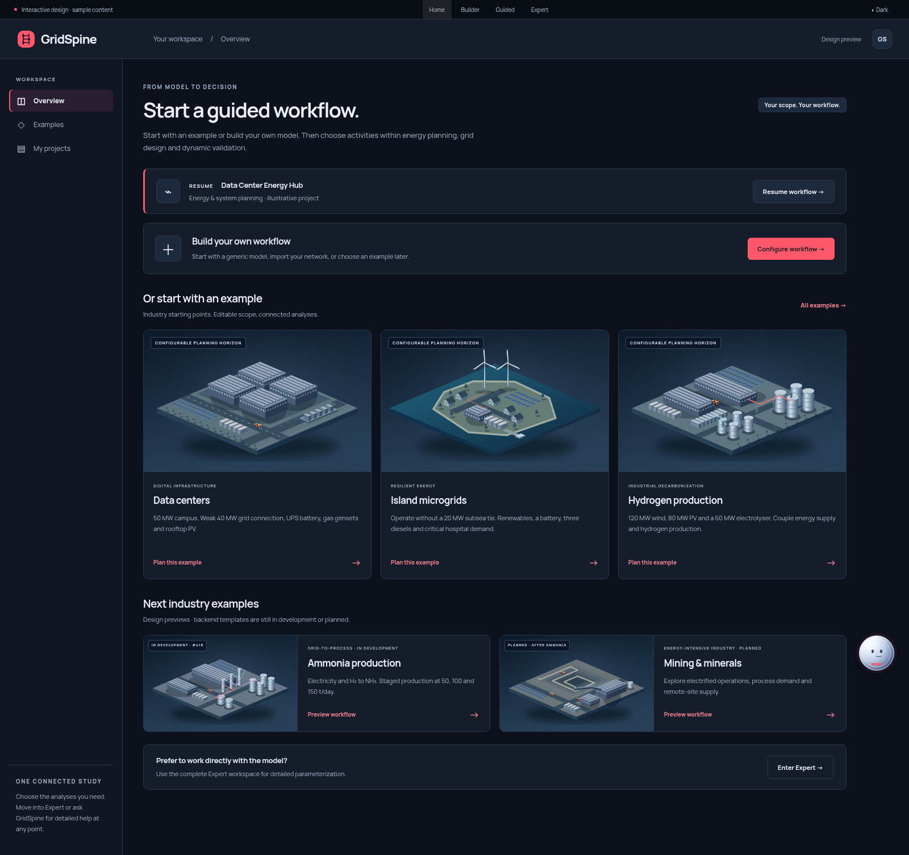

# GridSpine workspace redesign: implementation specification

Status: ready-for-agent

The owner requested publication of the latest modern industry-library and three-section workflow design for implementation. Start with the [implementation handoff](../../../.scratch/workspace-redesign/HANDOFF.md), [detailed specification and acceptance tests](../../../.scratch/workspace-redesign/spec.md) and [required backend separability assessment](../../../.scratch/workspace-redesign/backend-separability-assessment.md).

The package includes a [self-contained interactive HTML preview](../../../.scratch/workspace-redesign/GridSpine-modern.html), editable sources, original SVG illustrations, local licensed font/reference assets and bounded browser-verification evidence. Download the HTML and open it in a browser; GitHub's source view does not run it.

The design offers one integrated-planning card per industry, with direct click/right-click entry and editable planning years, marks ammonia as in development and mining as planned after ammonia, and places stress/synthetic load presets under Model & inputs. It preserves three work sections, editable scope, Expert and one companion with Write/Dictate/Live chat choices and distinct reduced-motion-aware animations.

This is a design/implementation specification, not a runtime rollout or certification of backend independence, domain correctness, simulation results or fresh full application tests. Native admission, source/evidence contracts and current-master compatibility remain implementation gates.
